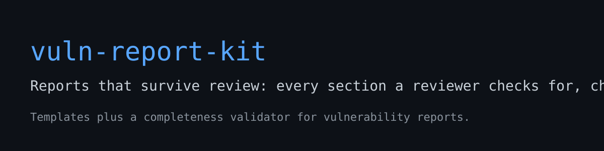

# vuln-report-kit



**Maintainers do not reject reports for weak findings nearly as often as they reject them for missing sections: no boundary statement, no control, no dedup note, a severity with no visible basis. This kit checks for all of that before the report leaves your machine.**

It is a template set plus a small validator CLI, distilled from a real disclosure campaign's rejections and the lessons they cost. The template teaches the shape while you write; the validator refuses to let a thin draft pass as a finished one.

## Install and run

No dependencies. Python 3.9 or newer.

```sh
git clone https://github.com/Epsilon0xCell/vuln-report-kit.git
cd vuln-report-kit
python3 vuln_report_check.py your-report.md
```

Exit code 0 means the draft carries every required element. Exit code 1 prints each missing element with the remedy:

```text
$ python3 vuln_report_check.py samples/bad-report.md
PASS  Title line
FAIL  Boundary statement from the project's own docs
      -> State what the project documents as intended behaviour, and cite the source (SECURITY.md, docs, threat model). If the behaviour is documented as intended, it is not a vulnerability.
FAIL  Benign control beside the proof
      -> Run the same steps with the trigger removed and report the result. A proof without its control is an anecdote.
FAIL  Deduplication note
      -> Say what you searched before filing (advisory database, issues, changelog, the project's own tracker) and what you found.
...
3/11 checks passed
RESULT: FAIL - fix the FAIL lines before this report goes anywhere
```

And the sample that passes, `samples/good-report.md`, scores 11/11. Read the two samples side by side; the contrast is the documentation.

## What it checks

| Check | The rejection it prevents |
|---|---|
| Boundary statement, sourced from the project's own docs | "This is documented, intended behaviour." The most expensive rejection there is, and the cheapest to prevent. |
| Affected versions, concretely named | "Which versions? All of them?" with the range never established. |
| Reproduction with a runnable artifact | A prose claim nobody can re-run, closed as unreproducible. |
| Benign control beside the proof | The proof that also "works" without the flaw. |
| Anchor comparison | The same proof triggering on the claimed fixed version, unnoticed by the reporter. |
| Deduplication note | The duplicate of a public issue or an internal tracker item, filed blind. |
| Impact as a demonstrated capability | "A crash is not a security issue." Impact stated as proximity instead of gain. |
| Severity with its basis | A score inflated past the preconditions, argued about instead of the flaw. |
| Preconditions | The non-default configuration and the privileged position buried in step 9. |
| Suggested fix | A report that hands the maintainer all of the work and none of the help. |

## The templates

- `templates/report-template.md`: the full report skeleton, with the reasoning for each section written into the section itself.
- `templates/cover-note.txt`: the short plain-text note for projects whose disclosure route is email. Plain prose, first person, the ask up front.

## Honest limits

- The validator checks presence and shape. It cannot check truth: a report can carry a boundary section that misquotes the docs and still pass. Verification of the finding itself is a separate discipline (the `verification-poc` skill in [ai-redteam-skills](https://github.com/Epsilon0xCell/ai-redteam-skills) covers it).
- The eleven checks are one campaign's standard, keyed to GitHub advisory and CNA routes. A specific project's policy always wins over this kit; several projects in the companion guide, [awesome-ai-red-teaming](https://github.com/Epsilon0xCell/awesome-ai-red-teaming), publish requirements that differ in detail.

## Tests

```sh
python3 -m unittest discover -s tests -v
```

Five tests: the good sample passes, the bad sample fails, the bad sample names its missing elements, removing the deduplication note alone flips the verdict, and a missing file is a clean error rather than a traceback.

## License

MIT. Written by Gavin Blacklock ([Epsilon0xCell](https://github.com/Epsilon0xCell)).
